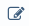

Banking
#######

The Banking module allows you to manage the school's bank accounts and track financial transactions — including cheque payments, deposits, and cash transfers — directly within sERP.

Access the Banking module from **Finance > Banking** in the main navigation menu. Requires the **Banking** access role.

.. _banking_accounts:

Managing Bank Accounts
**********************

Navigate to **Finance > Banking** to view the list of registered bank accounts.

Each account displays:

* Bank name
* Account name
* Account number
* Current balance

**Adding a Bank Account**

1. From the Banking list page, click **Add Bank Account**
2. Enter the following:

	* **Bank**: the name of the bank
	* **Account Name**: the name on the account
	* **Account Number**: the bank account number (numeric)

3. Click **Save**

**Removing a Bank Account**

From the bank accounts list, click the delete (|delete_icon|) button for the account you wish to remove and confirm.

.. warning::
	Deleting a bank account is irreversible and will remove all associated transaction records.

.. _banking_transactions:

Transaction Tracking
********************

Click on a bank account from the list to open its **Transaction Tracking** view. This shows all recorded transactions for the selected account within a given date range, along with the opening and closing balances.

**Filtering by date range**

Use the date range fields at the top of the transaction list to filter transactions by a specific period. Click **Filter** to apply.

**Recording a Cheque Payment**

1. From the transaction view, click the **Write Cheque** icon in the toolbar
2. Enter the cheque details (payee, amount, cheque number, date, description)
3. Click **Save**

**Recording a Deposit**

1. Click the **Enter Deposit** icon in the toolbar
2. Enter the deposit details (amount, date, description)
3. Click **Save**

**Recording a Cash Transfer**

1. Click the **Cash Transfer** icon in the toolbar
2. Enter the transfer details (amount, destination account, date, description)
3. Click **Save**

**Finding a Cheque**

Use the **Find Cheque** icon in the toolbar to search for a specific cheque by number.

**Printing / Exporting a Statement**

From the transaction toolbar, use:

* The **Print Statement** icon to print the current transaction list
* The **Export Statement** icon to download a PDF of the statement

.. _banking_finance_integration:

Integration with Finance
*************************

Bank Deposit payments and expenditure recorded elsewhere in sERP post directly to the Banking module, rather than needing to be re-entered here:

* A **Bank Deposit** fee payment (see :ref:`finance_payment`) credits the selected account automatically when recorded, and reverses that credit automatically if the payment is later cancelled.
* An **Expenditure** entry (see :ref:`Income and Expenditure <finance_income_expenditure>`) paid by Cheque or Bank Deposit debits the selected account automatically.
* A :ref:`Fixed Asset <finance_fixed_assets>` purchase, when recorded with a new Cheque or Bank Deposit payment, debits the selected account the same way, via the expenditure entry it creates.

These automatically-posted entries appear in the account's Transaction Tracking view alongside manually-entered cheques, deposits, and transfers, and are included in the account's running balance.

.. note::

	Bank Deposit fee payments and Expenditure both use this module's own list of accounts for their "Bank" field. For a fee payment specifically, this is distinct from the **Cheque** payment type's own "Bank" field, which instead identifies the *payer's* bank from a general reference list, since a cheque received from a parent isn't drawn on one of the school's own accounts.
